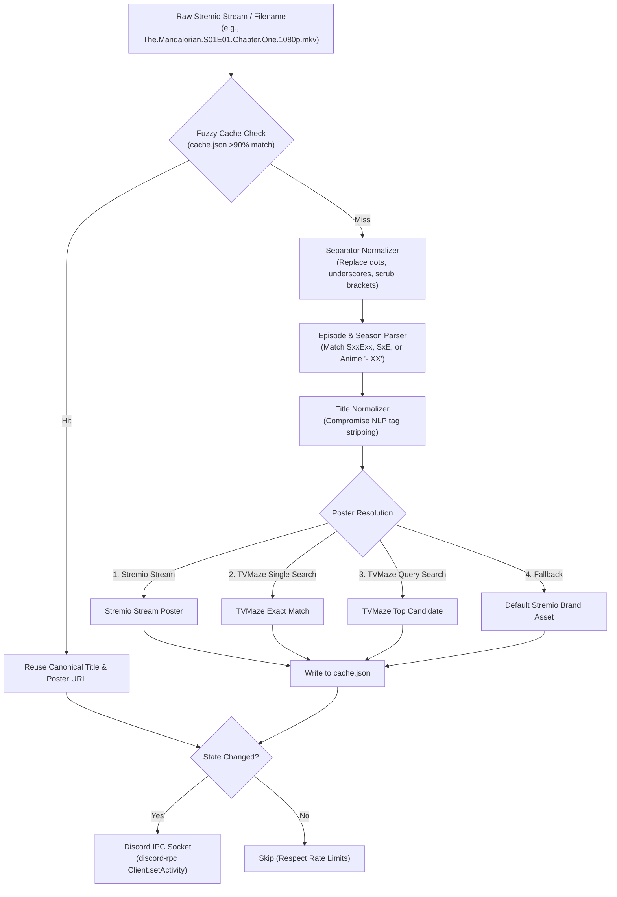

# Stremio Discord Rich Presence

> Lightweight daemon that monitors local Stremio playback, normalizes raw video filenames via NLP, fetches poster metadata, and broadcasts rich activity to Discord.

[](https://nodejs.org)
[](https://discord.com)
[](#testing--verification)
[](LICENSE)

`stremioRPC` runs as a background process alongside your Stremio desktop client. It polls Stremio's internal streaming server (`stats.json`), intercepts raw torrent video filenames (e.g., `[Reaktor] Fullmetal Alchemist Brotherhood - E04 v2 [1080p].mkv`), normalizes them into clean human-readable series titles and episode indices, resolves high-resolution cover posters, and synchronizes real-time playback state to your Discord profile without violating Discord rate limits.

---


## Filename Normalization & Metadata Pipeline

Raw video filenames often contain release groups, codec tags, resolution tags, and arbitrary delimiters. `stremioRPC` runs incoming streams through a multi-stage sanitization pipeline:



---

## Core Capabilities

- **Intelligent Title Normalization**:
  - Automatically handles western season/episode schemes (`S01E01`, `1x04`).
  - Corrects anime absolute episode numbering (e.g. `[HorribleSubs] My Hero Academia - 88`).
  - Strips release groups (`[VCB-Studio]`, `[Reaktor]`), audio specs (`Dual-Audio`, `flac`, `5.1`), codecs (`x265`, `HEVC`, `h264`), and resolution metadata (`1080p`, `720p`).
  - Normalizes titles using the `compromise` NLP library.
- **Multi-Stage Poster Resolution**:
  - Checks active Stremio stream metadata first.
  - Queries TVMaze Single Search API for official high-resolution key art.
  - Falls back to TVMaze General Search with fuzzy relevance weighting.
  - Reverts to a curated default Stremio asset if no external art is found.
- **Fuzzy In-Memory & Disk Caching**:
  - Maintains `cache.json` indexed by filename and similarity keys.
  - Employs `string-similarity` (Dice's Coefficient) with a 90% threshold to prevent repeated API calls for minor filename variations.
- **Rate-Limit & Polling Safety**:
  - Polls local endpoint every 15 seconds.
  - Performs differential state checks before dispatching calls to Discord's local IPC socket, preventing activity flood penalties.
- **Background macOS Daemon Support**: Includes a pre-configured `launchd` plist (`com.user.stremio-rpc.plist`) for automatic startup on login.

---

## Installation & Setup

### Prerequisites

- Node.js 18+
- [Stremio Desktop](https://www.stremio.com/) with local streaming server enabled (default port `11470`)
- Discord Desktop client running locally

### 1. Installation

```sh
git clone https://github.com/jsalg-byte/stremioRPC.git
cd stremioRPC

npm install
```

### 2. Configuration

Create a `.env` file in the project root:

```env
CLIENT_ID=3846067607497881711
STREMIO_ENDPOINT=http://127.0.0.1:11470/stats.json
```

| Variable | Description | Default |
| :--- | :--- | :--- |
| `CLIENT_ID` | Discord Application Client ID registered in Discord Developer Portal | `1462212189246062848` |
| `STREMIO_ENDPOINT` | Local Stremio streaming stats endpoint | `http://127.0.0.1:11470/stats.json` |

### 3. Running the Service

```sh
npm start
```

---

## Testing & Verification

The test suite validates title normalization and episode extraction against real-world torrent release conventions:

```sh
# Run sanitization and episode parsing test suite
npm test
```

### Verified Test Cases

| Input Filename | Sanitized Title | Parsed State |
| :--- | :--- | :--- |
| `Lucky Star - Episode 03 - Various People.mkv` | `Lucky Star` | `[1x3]` |
| `[Reaktor] Fullmetal Alchemist Brotherhood - E04 v2 [1080p][x265].mkv` | `Fullmetal Alchemist Brotherhood` | `[1x4]` |
| `The.Mandalorian.S01E01.Chapter.One.1080p.WEB-DL.x264.mkv` | `The Mandalorian` | `[1x1]` |
| `Attack.on.Titan.S04E12.720p.h264.mp4` | `Attack on Titan` | `[4x12]` |
| `Mushoku Tensei S02E15 [1080p].mkv` | `Mushoku Tensei` | `[2x15]` |

---

## macOS Auto-Start (launchd)

To run `stremioRPC` automatically in the background on macOS:

1. Update the node path and working directory in `com.user.stremio-rpc.plist`.
2. Copy the file to your user LaunchAgents folder:
   ```sh
   cp com.user.stremio-rpc.plist ~/Library/LaunchAgents/
   launchctl load ~/Library/LaunchAgents/com.user.stremio-rpc.plist
   ```

---

## Roadmap & Upcoming Enhancements

- Enhanced title extraction and heuristics for unconventional release naming formats
- Standalone feature film metadata resolution and duration tracking

---

## License

This project is licensed under the ISC License. See [LICENSE](LICENSE) for details.
